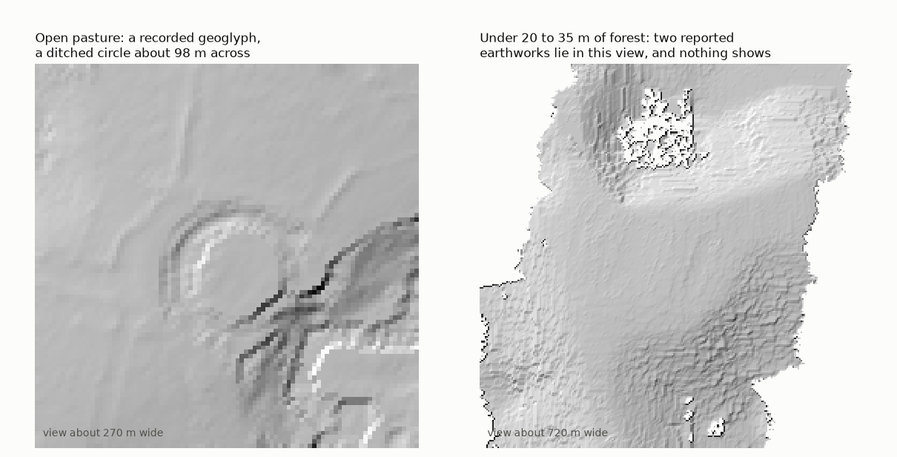
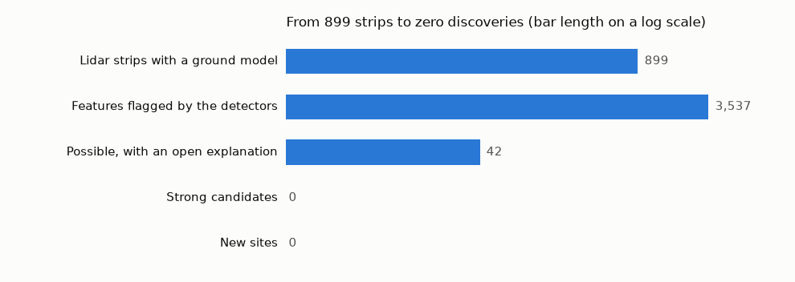
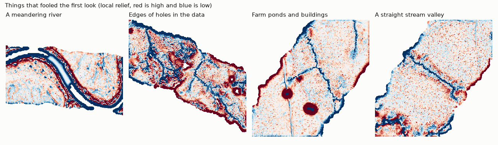

# Amazon-Earthworks-Lidar

[](LICENSE)




The Brazilian Amazon is full of ancient earthworks. People built giant ditched circles and squares, raised roads and mound villages there centuries before Europeans arrived, and most of them are still hidden under the forest. In 2023 a team of researchers estimated that more than 10,000 are waiting to be found.

I wanted to find one. I took every public lidar strip that Brazil flew over the Amazon to measure forest carbon, 899 strips in nine states, and sent an AI agent swarm through all of them for four and a half days. It flagged 3,537 shapes in the ground, argued against every one of them, and checked the survivors against every site register it could reach.

**It found nothing new.** The image above shows why. On the left is a recorded geoglyph in open pasture, and the lidar shows it perfectly. On the right are two earthworks that researchers reported under 20 to 35 m of forest, and in our ground model they are invisible. Almost no laser pulses reached the soil there. A search that cannot see under the trees cannot find what is hiding under the trees, and that is the honest result of this project.

## How it started

It began with Pietro Miotti's post [*My AI Agents (Re)discovered a Maya Site in 72 Hours*](https://pietromiotti.com/latest/maya-site/). He gave a team of AI agents public NASA lidar over the Maya lowlands, and within three days they had spotted what looked like an unrecorded settlement with a plaza and a pyramid. He reported it to Mexico's heritage institute. Later he learned that archaeologists had already mapped it in 2025, because his agents had missed that paper in their literature check. He said so openly in the post.

That honesty shaped this project. If someone with a working pipeline could rediscover a known site by accident, the record check had to be the most important step here, and every claim had to say how certain it was.

The Amazon version starts from the study by Peripato et al. (2023), [*More than 10,000 pre-Columbian earthworks are still hidden throughout Amazonia*](https://doi.org/10.1126/science.ade2541), in Science. Its authors searched about 5,300 km² of the same kind of carbon-survey lidar and found 24 earthworks that nobody had recorded. Their list of 961 known earthworks became our reference.

## What happened



The search ran in two stages. First I processed 12 strips in Acre on my laptop, where the famous geoglyphs are. The network was slow and the downloads kept dropping, so I handed the full search to an agent swarm on [Open Math OS](https://os.openmathmodel.org), which ran from 13 to 17 November 2026.

The swarm built a 3 m ground model for 899 of the 901 strips. The other two do not exist in the public archive. Its detectors looked for rings, mound clusters and raised lines, and a separate group of agents tried to explain each detection away as a river, a road, a pond or a processing error. Most of the time they succeeded.

| Result | Count |
| --- | ---: |
| Lidar strips with a ground model | 899 |
| Shapes flagged by the detectors | 3,537 |
| Rejected with a written reason | 3,494 |
| Possible, but a natural or modern explanation is still open | 42 |
| Recorded site found again (the test site) | 1 |
| Strong candidates | 0 |
| New sites | 0 |

I looked at every one of the 42 Possible features myself. Most are gully heads, stream junctions, plough lines, field plots and roads. Six are harder to explain: five short straight ridges under tall forest and one flat surface dotted with small regular bumps. Natural levees, old forest tracks and natural earth mounds can all make those shapes, and none of the six looks like a geoglyph. The full numbers are in [docs/results.md](docs/results.md).

## Why it found nothing

There are two reasons, and both are useful to know before you try this yourself.

**The forest hides the ground.** These strips were flown to measure trees, and they have about 2 laser returns per square metre. Under tall canopy very few of those reach the soil. Five strips contain earthworks that Peripato and colleagues reported under forest. At all five, our detector could read between 0 and 0.2 percent of the ground around the reported point, and the images show nothing. It is possible that their published positions are shifted on purpose, which is common for archaeological sites. Either way, our search never proved it could see an earthwork under forest, so a blank result there means nothing.

**Most of what looks ancient is not.** The first look at any relief image is full of circles and lines. Rivers bend into arcs, cattle ponds make perfect rings, holes in the data make fake enclosures, and straight stream valleys look like old roads. These are some of the ones that fooled us at first:



## Lessons for anyone who tries this

- **Check your test site first.** The recorded geoglyph in strip 0414 was the first thing we looked for. When the pipeline found it, we knew it worked in pasture. We never found a test site that worked under forest, and that one missing check decides the whole result.
- **Do not trust the ground label.** In these files, points marked as ground reach up to 40 m into the canopy. A model built from them is noise. Both pipelines here find the ground themselves.
- **Match the cell size to the data.** With about 2 points per m², 1 m cells are mostly empty under trees, and 3 m cells work better.
- **Blank the edges of holes.** Ponds, buildings and dense canopy leave holes in the data, and relief filters draw rings around them that look exactly like small enclosures.
- **Check the records before you get excited.** Miotti's site was already published. Ours never got that far, but the check was ready.

## Ideas for other uses

The same tools work anywhere someone needs to find small shapes in the ground that trees or grass hide. If you want to build on this, here are some ideas.

- **Archaeology in other forests.** Public lidar covers parts of Central America, Southeast Asia, Central Africa and European woodland. Old field walls, charcoal hearths, hillforts and lost roads show up in the same relief images. Lidar flown for archaeology has far more ground returns than carbon surveys, so it is a better place to start.
- **Old mines and industry.** Abandoned mine shafts, spoil heaps, canals and mill ponds hide in woodland across Europe and North America. Mapping them helps with land safety and local history.
- **Wartime landscapes.** Trenches, shell craters and bunkers from the World Wars survive under forest in France, Belgium and Eastern Europe. Mapping them helps historians and also bomb disposal teams.
- **Geology and hazards.** Fault scarps, old landslides and sinkholes look like ditches and mounds in a relief model. The same filters can screen for them before a road or a building is planned.
- **Ecology.** Termite mounds, beaver dams, animal trails and old river channels shape forests. Counting them over large areas is slow on foot and quick in lidar.
- **Testing any automated search.** Put a known example into the data first and make sure the method finds it. Then find out where it is blind, and report that limit as clearly as the results.
- **Agent swarms for careful science.** The swarm spent most of its time testing detectors and correcting its own claims. The same setup could screen satellite images, telescope surveys or old maps for things that must be checked against records before anyone calls them new.

## What is in this repository

| Path | Contents |
| --- | --- |
| [`src/`](src/) | The laptop pipeline: ground model and relief tiles (`dtm.py`), a resumable downloader (`batch.py`), a region viewer with canopy height (`inspect_region.py`), and distance checks against known sites (`crosscheck.py`, `known_in_grid.py`) |
| [`swarm_code/`](swarm_code/) | The scripts the agent swarm wrote for processing, screening, skeptic review, record checks and archive audits |
| [`docs/results.md`](docs/results.md) | Every number from the search |
| [`docs/swarm_review.md`](docs/swarm_review.md) | A review of what the swarm did well and where it fell short |
| [`docs/make_figures.py`](docs/make_figures.py) | The script that draws the figures in this README |

No positions of any feature are published here. Exact positions of possible archaeological sites can lead to looting, so they stay private, and the swarm's reference data folder was left out for the same reason. A few audit scripts in `swarm_code/` therefore point at files that are not included.

## Run it

The laptop pipeline needs Python 3.10 or later.

```bash
pip install -r requirements.txt
python src/batch.py 0414
python src/known_in_grid.py data/raw/NP_T-0414.laz outputs/private/T-0414
```

The first command downloads strip 0414 from Zenodo (about 220 MB) and writes a ground model and review tiles to `outputs/private/T-0414`. Look for the circle in the tiles. The second command lists recorded earthworks near the strip. It needs the Peripato table saved as `data/ref/earthworks_known.csv` with the columns Longitude, Latitude and Database.

## Data and credits

- Lidar: EBA (Estimativa de Biomassa na Amazônia) L1A transects from INPE, CC BY 4.0, on Zenodo (records 7689909, 7636454, 7689693 and 7689210), with footprints in record 4968706.
- Known sites: the data release of Peripato et al. 2023 (Zenodo record 8083287), which combines Amazon Arch, PAST, CNSA (IPHAN), INRAP and DAC, and the authors' own finds.
- Inspiration: Pietro Miotti, [*My AI Agents (Re)discovered a Maya Site in 72 Hours*](https://pietromiotti.com/latest/maya-site/).

No lidar data is stored in this repository. The code is under the MIT licence.
